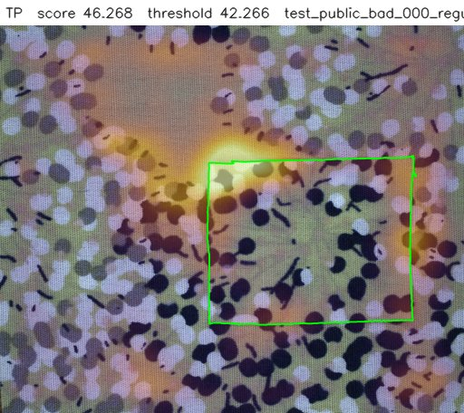
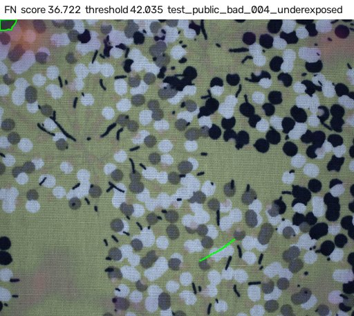
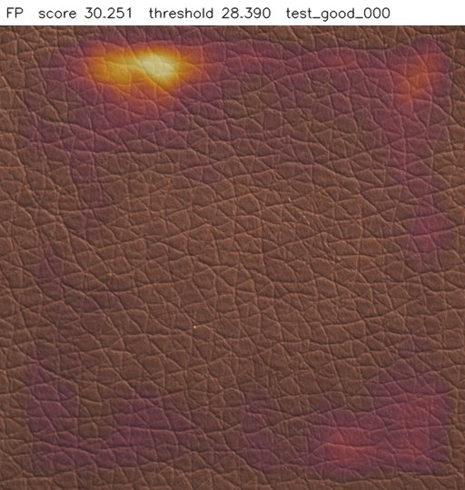
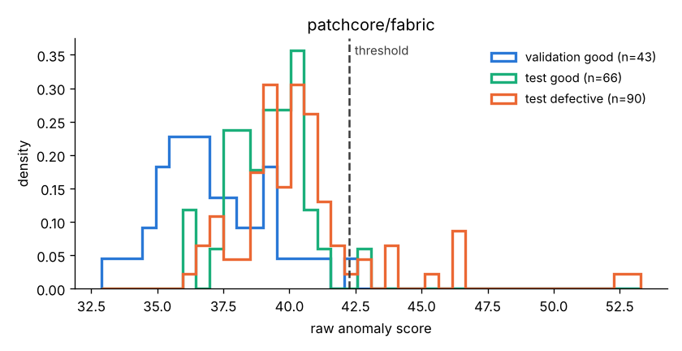

# Visual Quality Inspection

Anomaly detection for visual quality control that learns from good parts only, sets its
decision threshold from good validation images only, and reports what it misses.

> **Status:** Phases 1 to 3 are done (baseline, metrics, EfficientAD comparison,
> robustness). Phases 4 to 7 are planned (see [Project status](#project-status)). Every
> result number in this README is checked against `results/*.json` in CI by
> `scripts/check_readme_claims.py`.

## Problem

Products leave the line with visual defects (scratches, holes, cuts, stains, colour errors,
contamination, missing parts) and reach the customer. Manual inspection is slow and
inconsistent. Defect samples are rare on a real line, so this system learns from good parts
only. It flags anomalies, shows where they are, and logs every decision so quality
engineers can audit it.

The pipeline is product-agnostic: a new product needs a new config file and new training
images, not new code.

## Key results

<!-- results:start -->
| Category | PatchCore AUROC | PatchCore recall at threshold | EfficientAD AUROC |
|---|---|---|---|
| fabric (main set, harder) | 0.751<!-- claim: results/metrics.json#patchcore/fabric.image.image_auroc.value --> | 0.211<!-- claim: results/metrics.json#patchcore/fabric.image.recall.value --> | 0.551<!-- claim: results/metrics.json#efficientad/fabric.image.image_auroc.value --> |
| leather | 1.000<!-- claim: results/metrics.json#patchcore/leather.image.image_auroc.value --> | 1.000<!-- claim: results/metrics.json#patchcore/leather.image.recall.value --> | 0.921<!-- claim: results/metrics.json#efficientad/leather.image.image_auroc.value --> |
| carpet | 0.987<!-- claim: results/metrics.json#patchcore/carpet.image.image_auroc.value --> | 0.978<!-- claim: results/metrics.json#patchcore/carpet.image.recall.value --> | 0.990<!-- claim: results/metrics.json#efficientad/carpet.image.image_auroc.value --> |
<!-- results:end -->

Both models are trained on good images only; each threshold is chosen on good validation
images for a 1%<!-- claim: results/thresholds.json#patchcore/fabric.target_false_alarm_rate --> false-alarm target, and the test split is scored once. Full
tables with 95% bootstrap intervals, false-alarm rates and pixel AU-PRO:
[`results/metrics.md`](results/metrics.md) and [`results/robustness.md`](results/robustness.md).

<table>
<tr>
<td></td>
<td></td>
<td></td>
</tr>
<tr>
<td><b>Caught</b> (fabric). Large defect area (green outline); the heatmap peaks at its edge.</td>
<td><b>Missed</b> (fabric). A thin line that looks like the printed pattern; at 256 px it nearly disappears.</td>
<td><b>False alarm</b> (leather). A good part with a bright patch near the border.</td>
</tr>
</table>



*PatchCore on fabric: defective (orange) and good test parts (green) overlap heavily, and
good test parts score higher than the good validation images (blue) that set the threshold.*

What this shows:

- **The harder dataset is hard for both models.** On MVTec AD 2 `fabric` PatchCore misses
  78.9%<!-- claim: results/metrics.json#patchcore/fabric.image.miss_rate.value --> of defective images at its threshold, with an AUROC interval of
  [0.570<!-- claim: results/metrics.json#patchcore/fabric.image.image_auroc.ci95.0 -->, 0.909<!-- claim: results/metrics.json#patchcore/fabric.image.image_auroc.ci95.1 -->] over only 26<!-- claim: results/metrics.json#patchcore/fabric.image.n_test_parts --> physical test parts.
- **EfficientAD lost to PatchCore** (a negative result, kept on purpose). It is worse on
  `leather` and `fabric`, and its validation threshold does not transfer: on the test good
  parts it raised false alarms on 56.1%<!-- claim: results/metrics.json#efficientad/fabric.image.false_alarm_rate.value --> (fabric) and 25.0%<!-- claim: results/metrics.json#efficientad/carpet.image.false_alarm_rate.value --> (carpet). It was
  trained for 10 epochs, far below the paper's budget, so this is "EfficientAD at this
  budget", not the method's best.
- **A 1% target on about 50 validation images is not a 1% guarantee.** With 43<!-- claim: results/thresholds.json#patchcore/fabric.n_validation_images --> to 56<!-- claim: results/thresholds.json#patchcore/carpet.n_validation_images --> good
  validation images each threshold is simply the highest validation score. PatchCore's
  test false-alarm rate was 18.8%<!-- claim: results/metrics.json#patchcore/leather.image.false_alarm_rate.value --> on leather and 10.7%<!-- claim: results/metrics.json#patchcore/carpet.image.false_alarm_rate.value --> on carpet.
- **Run-to-run variation is real.** The same code and seed gave a PatchCore fabric AUROC of
  0.657<!-- claim: results/history/phase2_colab_t4/metrics.json#patchcore/fabric.image.image_auroc.value --> on a Colab T4 (Phase 2) and 0.751<!-- claim: results/metrics.json#patchcore/fabric.image.image_auroc.value --> on an RTX 3070 Ti (Phase 3). Both lie inside
  the other's interval, which is why every number here carries one.

## Robustness: the ranking survives, the threshold does not

Test images perturbed at full resolution (darker x0.7, brighter x1.3, Gaussian blur,
Gaussian noise); each model keeps its clean threshold, as a line would after a camera or
lighting change. Leather, where both models work on clean images:

<!-- results:start -->
| Condition | PatchCore AUROC | PatchCore false-alarm rate | EfficientAD AUROC |
|---|---|---|---|
| clean | 1.000<!-- claim: results/robustness.json#patchcore/leather.clean.image_auroc.value --> | 0.188<!-- claim: results/robustness.json#patchcore/leather.clean.false_alarm_rate.value --> | 0.921<!-- claim: results/robustness.json#efficientad/leather.clean.image_auroc.value --> |
| darker | 1.000<!-- claim: results/robustness.json#patchcore/leather.brightness_0.7.image_auroc.value --> | 0.125<!-- claim: results/robustness.json#patchcore/leather.brightness_0.7.false_alarm_rate.value --> | 0.895<!-- claim: results/robustness.json#efficientad/leather.brightness_0.7.image_auroc.value --> |
| brighter | 1.000<!-- claim: results/robustness.json#patchcore/leather.brightness_1.3.image_auroc.value --> | 0.656<!-- claim: results/robustness.json#patchcore/leather.brightness_1.3.false_alarm_rate.value --> | 0.463<!-- claim: results/robustness.json#efficientad/leather.brightness_1.3.image_auroc.value --> |
| blur | 1.000<!-- claim: results/robustness.json#patchcore/leather.blur.image_auroc.value --> | 1.000<!-- claim: results/robustness.json#patchcore/leather.blur.false_alarm_rate.value --> | 0.628<!-- claim: results/robustness.json#efficientad/leather.blur.image_auroc.value --> |
| noise | 1.000<!-- claim: results/robustness.json#patchcore/leather.noise.image_auroc.value --> | 0.438<!-- claim: results/robustness.json#patchcore/leather.noise.false_alarm_rate.value --> | 0.923<!-- claim: results/robustness.json#efficientad/leather.noise.image_auroc.value --> |
<!-- results:end -->

Under blur PatchCore still ranks every part correctly, yet with the clean threshold it
rejects 100.0%<!-- claim: results/robustness.json#patchcore/leather.blur.false_alarm_rate.value --> of the good parts. On a line this means monitoring the scores of good
parts and recalibrating the threshold after any optics or lighting change. EfficientAD is
more fragile: brighter images drop its leather AUROC to 0.463<!-- claim: results/robustness.json#efficientad/leather.brightness_1.3.image_auroc.value -->.

More: failure galleries in `results/<model>/<category>/overlays/` (true positives, misses,
false alarms); decisions and negative results in [`docs/decisions.md`](docs/decisions.md).

## Demo data

Public datasets are used as examples only (non-commercial licence, see [DATA.md](DATA.md)):
MVTec AD 2 `fabric` (main), MVTec AD `leather` and `carpet` (secondary).

## Quick start

```bash
pip install -e ".[dev]"
pytest
```

Put a dataset in place (details in [DATA.md](DATA.md)), then train and evaluate a model
(GPU notebooks in `notebooks/` do the same steps on Colab or Kaggle):

```bash
python scripts/download_data.py --config configs/leather.yaml --source /path/to/leather.tar.xz
python scripts/train_anomaly.py --config configs/leather.yaml --model configs/models/patchcore.yaml
python scripts/evaluate.py --model configs/models/patchcore.yaml configs/leather.yaml
```

## Models

- **PatchCore** (`configs/models/patchcore.yaml`): memory bank of pretrained patch features.
- **EfficientAD** (`configs/models/efficient_ad.yaml`): student-teacher network with an
  autoencoder. The method was published by MVTec researchers; check its patent and
  licence status before any commercial use (see `docs/decisions.md`, D33).

## Project status

| Phase | Content | Status |
|---|---|---|
| 1 | Skeleton, configs, data script, CI | done |
| 2 | PatchCore baseline, validation-only threshold, metrics, failure overlays | done |
| 3 | EfficientAD comparison, robustness to perturbations | done |
| 4 | Defect-type classifier (ResNet18 vs HOG + SVM), hybrid pipeline | planned |
| 5 | ONNX / OpenVINO export, CPU latency | planned |
| 6 | FastAPI line integration, SQLite decision log, Docker | planned |
| 7 | Operator panel, final README | planned |

Design decisions and negative results are logged in [docs/decisions.md](docs/decisions.md).

## License

Code: MIT. Datasets and any weights trained on them: CC BY-NC-SA 4.0 (see [DATA.md](DATA.md)).
