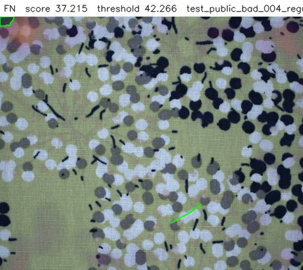
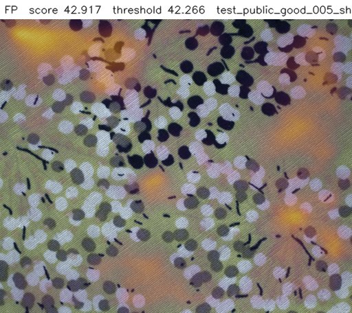

# Visual Quality Inspection

Anomaly detection for visual quality control that learns from good parts only, sets its
decision threshold from good validation images only, and reports what it misses.

> **Status:** Phases 1 and 2 are done. Phase 3 (EfficientAD comparison, robustness) has its
> code in the repository; its results are pending a GPU run. Phases 4 to 7 are planned
> (see [Project status](#project-status)). Every result number in this README is checked
> against `results/*.json` in CI by `scripts/check_readme_claims.py`.

## Problem

Products leave the line with visual defects (scratches, holes, cuts, stains, colour errors,
contamination, missing parts) and reach the customer. Manual inspection is slow and
inconsistent. Defect samples are rare on a real line, so this system learns from good parts
only. It flags anomalies, shows where they are, and logs every decision so quality
engineers can audit it.

The pipeline is product-agnostic: a new product needs a new config file and new training
images, not new code.

## Key results (PatchCore baseline)

<!-- results:start -->
| Category | Image AUROC | Recall at threshold |
|---|---|---|
| fabric (main set, harder) | 0.657<!-- claim: results/metrics.json#patchcore/fabric.image.image_auroc.value --> | 0.144<!-- claim: results/metrics.json#patchcore/fabric.image.recall.value --> |
| leather | 1.000<!-- claim: results/metrics.json#patchcore/leather.image.image_auroc.value --> | 1.000<!-- claim: results/metrics.json#patchcore/leather.image.recall.value --> |
| carpet | 0.988<!-- claim: results/metrics.json#patchcore/carpet.image.image_auroc.value --> | 0.978<!-- claim: results/metrics.json#patchcore/carpet.image.recall.value --> |
<!-- results:end -->

The threshold is chosen on good validation images for a 1%<!-- claim: results/thresholds.json#patchcore/fabric.target_false_alarm_rate --> false-alarm target;
the test split is scored once. Full table with 95% bootstrap intervals, false-alarm rates
and pixel AU-PRO: [`results/metrics.md`](results/metrics.md).

<table>
<tr>
<td></td>
<td></td>
<td></td>
</tr>
<tr>
<td><b>Caught.</b> Large defect area (green outline); the heatmap peaks at its edge.</td>
<td><b>Missed.</b> A thin line that looks like the printed pattern; after resizing to 256 px it nearly disappears.</td>
<td><b>False alarm.</b> A good part under shifted light; the heatmap follows the lit areas, not a defect.</td>
</tr>
</table>


*Fabric scores: defective (orange) and good test parts (green) overlap almost completely,
and good test parts score higher than the good validation images (blue) that set the
threshold.*

What this shows:

- **The harder dataset is genuinely hard for this baseline.** On MVTec AD 2 `fabric` the
  threshold misses 85.6%<!-- claim: results/metrics.json#patchcore/fabric.image.miss_rate.value --> of defective images, and the AUROC interval reaches
  down to 0.473<!-- claim: results/metrics.json#patchcore/fabric.image.image_auroc.ci95.0 -->: with 26<!-- claim: results/metrics.json#patchcore/fabric.image.n_test_parts --> physical test parts it is not clearly better than chance.
- **A 1% target on about 50 validation images is not a 1% guarantee.** The thresholds come
  from 43<!-- claim: results/thresholds.json#patchcore/fabric.n_validation_images -->, 49<!-- claim: results/thresholds.json#patchcore/leather.n_validation_images --> and 56<!-- claim: results/thresholds.json#patchcore/carpet.n_validation_images --> good images, so each one is simply the highest validation
  score. On the test good parts the false-alarm rate was 3.0%<!-- claim: results/metrics.json#patchcore/fabric.image.false_alarm_rate.value --> (fabric),
  9.4%<!-- claim: results/metrics.json#patchcore/leather.image.false_alarm_rate.value --> (leather) and 7.1%<!-- claim: results/metrics.json#patchcore/carpet.image.false_alarm_rate.value --> (carpet). On a line the threshold needs more good
  images, taken under the line's own lighting.
- `leather` and `carpet` (MVTec AD) are close to saturated, as expected for that dataset.

More: failure gallery in `results/patchcore/<category>/overlays/` (true positives, misses,
false alarms); decisions and negative results in [`docs/decisions.md`](docs/decisions.md).

## Demo data

Public datasets are used as examples only (non-commercial licence, see [DATA.md](DATA.md)):
MVTec AD 2 `fabric` (main), MVTec AD `leather` and `carpet` (secondary).

## Quick start

```bash
pip install -e ".[dev]"
pytest
```

Put a dataset in place (details in [DATA.md](DATA.md)), then train and evaluate a model
(GPU notebooks in `notebooks/` do the same steps on Colab or Kaggle):

```bash
python scripts/download_data.py --config configs/leather.yaml --source /path/to/leather.tar.xz
python scripts/train_anomaly.py --config configs/leather.yaml --model configs/models/patchcore.yaml
python scripts/evaluate.py --model configs/models/patchcore.yaml configs/leather.yaml
```

## Models

- **PatchCore** (`configs/models/patchcore.yaml`): memory bank of pretrained patch features.
- **EfficientAD** (`configs/models/efficient_ad.yaml`): student-teacher network with an
  autoencoder. The method was published by MVTec researchers; check its patent and
  licence status before any commercial use (see `docs/decisions.md`, D33).

## Project status

| Phase | Content | Status |
|---|---|---|
| 1 | Skeleton, configs, data script, CI | done |
| 2 | PatchCore baseline, validation-only threshold, metrics, failure overlays | done |
| 3 | EfficientAD comparison, robustness to perturbations | code done, results pending |
| 4 | Defect-type classifier (ResNet18 vs HOG + SVM), hybrid pipeline | planned |
| 5 | ONNX / OpenVINO export, CPU latency | planned |
| 6 | FastAPI line integration, SQLite decision log, Docker | planned |
| 7 | Operator panel, final README | planned |

Design decisions and negative results are logged in [docs/decisions.md](docs/decisions.md).

## License

Code: MIT. Datasets and any weights trained on them: CC BY-NC-SA 4.0 (see [DATA.md](DATA.md)).
