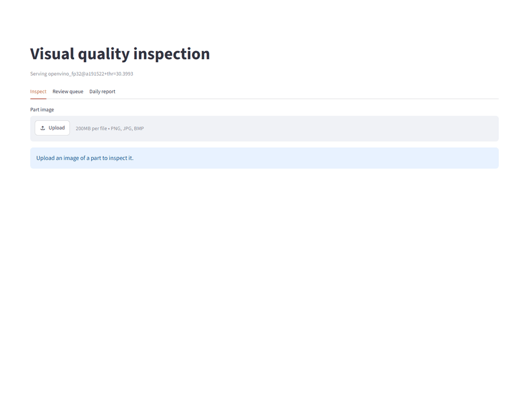

# Visual Quality Inspection

**Problem:** visual defects (cuts, stains, colour errors) slip past manual inspection, and
real lines have too few defect samples to train a classifier on.

**Approach:** an anomaly model (PatchCore) learns from good parts only and sets its
threshold from good validation images only; a small classifier (ResNet18) names the defect
type of rejected parts; both run exported to OpenVINO on a CPU behind a FastAPI service with
a decision log and an operator panel.

**Main result** on MVTec AD `leather`, the served model on held-out test images:
- every defect caught (recall 1.000<!-- claim: results/export/patchcore/leather/export.json#formats.openvino_fp32.image.recall.value -->, image AUROC 1.000<!-- claim: results/export/patchcore/leather/export.json#formats.openvino_fp32.image.image_auroc.value -->), at the cost of false alarms on
  12.5%<!-- claim: results/export/patchcore/leather/export.json#formats.openvino_fp32.image.false_alarm_rate.value --> of good parts;
- defect type right for 96.7%<!-- claim: results/classifier/leather/classifier.json#models.resnet18.accuracy.value --> of defects (95% interval 92.4%<!-- claim: results/classifier/leather/classifier.json#models.resnet18.accuracy.ci95.0 --> to 100.0%<!-- claim: results/classifier/leather/classifier.json#models.resnet18.accuracy.ci95.1 -->, cross-validated);
- median 177.3<!-- claim: results/export/patchcore/leather/export.json#formats.openvino_fp32.latency.median_ms --> ms per image on a desktop CPU.

On the harder MVTec AD 2 `fabric` the same method misses 78.9%<!-- claim: results/metrics.json#patchcore/fabric.image.miss_rate.value --> of defects: see
[Key results](#key-results).



*The operator panel, recorded by `scripts/make_demo_gif.py`: three parts inspected, then the
review queue and the daily report of a replayed shift.*

> **Status:** all seven phases are done (see [Project status](#project-status)). Every
> result number in this README is checked against `results/*.json` in CI by
> `scripts/check_readme_claims.py`.

## Problem

Products leave the line with visual defects (scratches, holes, cuts, stains, colour errors,
contamination, missing parts) and reach the customer. Manual inspection is slow and
inconsistent. Defect samples are rare on a real line, so this system learns from good parts
only. It flags anomalies, shows where they are, and logs every decision so quality
engineers can audit it.

The pipeline is product-agnostic: a new product needs a new config file and new training
images, not new code.

## Key results

<!-- results:start -->
| Category | PatchCore AUROC | PatchCore recall at threshold | EfficientAD AUROC |
|---|---|---|---|
| fabric (main set, harder) | 0.751<!-- claim: results/metrics.json#patchcore/fabric.image.image_auroc.value --> | 0.211<!-- claim: results/metrics.json#patchcore/fabric.image.recall.value --> | 0.551<!-- claim: results/metrics.json#efficientad/fabric.image.image_auroc.value --> |
| leather | 1.000<!-- claim: results/metrics.json#patchcore/leather.image.image_auroc.value --> | 1.000<!-- claim: results/metrics.json#patchcore/leather.image.recall.value --> | 0.921<!-- claim: results/metrics.json#efficientad/leather.image.image_auroc.value --> |
| carpet | 0.987<!-- claim: results/metrics.json#patchcore/carpet.image.image_auroc.value --> | 0.978<!-- claim: results/metrics.json#patchcore/carpet.image.recall.value --> | 0.990<!-- claim: results/metrics.json#efficientad/carpet.image.image_auroc.value --> |
<!-- results:end -->

Both models are trained on good images only; each threshold is chosen on good validation
images for a 1%<!-- claim: results/thresholds.json#patchcore/fabric.target_false_alarm_rate --> false-alarm target, and the test split is scored once. Full
tables with 95% bootstrap intervals, false-alarm rates and pixel AU-PRO:
[`results/metrics.md`](results/metrics.md) and [`results/robustness.md`](results/robustness.md).

<table>
<tr>
<td></td>
<td></td>
<td></td>
</tr>
<tr>
<td><b>Caught</b> (fabric). Large defect area (green outline); the heatmap peaks at its edge.</td>
<td><b>Missed</b> (fabric). A thin line that looks like the printed pattern; at 256 px it nearly disappears.</td>
<td><b>False alarm</b> (leather). A good part with a bright patch near the border.</td>
</tr>
</table>


*PatchCore on fabric: defective (orange) and good test parts (green) overlap heavily, and
good test parts score higher than the good validation images (blue) that set the threshold.*

What this shows:

- **The harder dataset is hard for both models.** On MVTec AD 2 `fabric` PatchCore misses
  78.9%<!-- claim: results/metrics.json#patchcore/fabric.image.miss_rate.value --> of defective images at its threshold, with an AUROC interval of
  [0.570<!-- claim: results/metrics.json#patchcore/fabric.image.image_auroc.ci95.0 -->, 0.909<!-- claim: results/metrics.json#patchcore/fabric.image.image_auroc.ci95.1 -->] over only 26<!-- claim: results/metrics.json#patchcore/fabric.image.n_test_parts --> physical test parts.
- **EfficientAD lost to PatchCore** (a negative result, kept on purpose). It is worse on
  `leather` and `fabric`, and its validation threshold does not transfer: on the test good
  parts it raised false alarms on 56.1%<!-- claim: results/metrics.json#efficientad/fabric.image.false_alarm_rate.value --> (fabric) and 25.0%<!-- claim: results/metrics.json#efficientad/carpet.image.false_alarm_rate.value --> (carpet). It was
  trained for 10 epochs, far below the paper's budget, so this is "EfficientAD at this
  budget", not the method's best.
- **A 1% target on about 50 validation images is not a 1% guarantee.** With 43<!-- claim: results/thresholds.json#patchcore/fabric.n_validation_images --> to 56<!-- claim: results/thresholds.json#patchcore/carpet.n_validation_images --> good
  validation images each threshold is simply the highest validation score. PatchCore's
  test false-alarm rate was 18.8%<!-- claim: results/metrics.json#patchcore/leather.image.false_alarm_rate.value --> on leather and 10.7%<!-- claim: results/metrics.json#patchcore/carpet.image.false_alarm_rate.value --> on carpet.
- **Run-to-run variation is real.** The same code and seed gave a PatchCore fabric AUROC of
  0.657<!-- claim: results/history/phase2_colab_t4/metrics.json#patchcore/fabric.image.image_auroc.value --> on a Colab T4 (Phase 2) and 0.751<!-- claim: results/metrics.json#patchcore/fabric.image.image_auroc.value --> on an RTX 3070 Ti (Phase 3). Both lie inside
  the other's interval, which is why every number here carries one.

## Robustness: the ranking survives, the threshold does not

Test images perturbed at full resolution (darker x0.7, brighter x1.3, Gaussian blur,
Gaussian noise); each model keeps its clean threshold, as a line would after a camera or
lighting change. Leather, where both models work on clean images:

<!-- results:start -->
| Condition | PatchCore AUROC | PatchCore false-alarm rate | EfficientAD AUROC |
|---|---|---|---|
| clean | 1.000<!-- claim: results/robustness.json#patchcore/leather.clean.image_auroc.value --> | 0.188<!-- claim: results/robustness.json#patchcore/leather.clean.false_alarm_rate.value --> | 0.921<!-- claim: results/robustness.json#efficientad/leather.clean.image_auroc.value --> |
| darker | 1.000<!-- claim: results/robustness.json#patchcore/leather.brightness_0.7.image_auroc.value --> | 0.125<!-- claim: results/robustness.json#patchcore/leather.brightness_0.7.false_alarm_rate.value --> | 0.895<!-- claim: results/robustness.json#efficientad/leather.brightness_0.7.image_auroc.value --> |
| brighter | 1.000<!-- claim: results/robustness.json#patchcore/leather.brightness_1.3.image_auroc.value --> | 0.656<!-- claim: results/robustness.json#patchcore/leather.brightness_1.3.false_alarm_rate.value --> | 0.463<!-- claim: results/robustness.json#efficientad/leather.brightness_1.3.image_auroc.value --> |
| blur | 1.000<!-- claim: results/robustness.json#patchcore/leather.blur.image_auroc.value --> | 1.000<!-- claim: results/robustness.json#patchcore/leather.blur.false_alarm_rate.value --> | 0.628<!-- claim: results/robustness.json#efficientad/leather.blur.image_auroc.value --> |
| noise | 1.000<!-- claim: results/robustness.json#patchcore/leather.noise.image_auroc.value --> | 0.438<!-- claim: results/robustness.json#patchcore/leather.noise.false_alarm_rate.value --> | 0.923<!-- claim: results/robustness.json#efficientad/leather.noise.image_auroc.value --> |
<!-- results:end -->

Under blur PatchCore still ranks every part correctly, yet with the clean threshold it
rejects 100.0%<!-- claim: results/robustness.json#patchcore/leather.blur.false_alarm_rate.value --> of the good parts. On a line this means monitoring the scores of good
parts and recalibrating the threshold after any optics or lighting change. EfficientAD is
more fragile: brighter images drop its leather AUROC to 0.463<!-- claim: results/robustness.json#efficientad/leather.brightness_1.3.image_auroc.value -->.

More: failure galleries in `results/<model>/<category>/overlays/` (true positives, misses,
false alarms); decisions and negative results in [`docs/decisions.md`](docs/decisions.md).

## Deployment: export and CPU latency

The PatchCore `leather` model was exported with a fixed input of one camera image
(1024<!-- claim: results/export/patchcore/leather/export.json#input_size.0 --> x 1024<!-- claim: results/export/patchcore/leather/export.json#input_size.1 --> px; the graph contains the model's own resize and normalisation).
Every format gets its own threshold from the good validation images, because the exported
resize differs slightly from training. Latency: CPU only, one image at a time, decoding
excluded, 10<!-- claim: results/export/patchcore/leather/export.json#formats.openvino_int8.latency.n_warmup --> warm-up runs, then all 124<!-- claim: results/export/patchcore/leather/export.json#formats.openvino_int8.latency.n_timed --> test images; measured on an Intel Core
`i5-12400F`<!-- claim: results/export/patchcore/leather/export.json#environment.cpu --> desktop CPU with 12<!-- claim: results/export/patchcore/leather/export.json#environment.logical_cores --> logical cores (details in `export.json`).

<!-- results:start -->
| Format | Size (MB) | Median ms/image | p95 ms/image | Image AUROC | False-alarm rate |
|---|---|---|---|---|---|
| PyTorch FP32 (baseline) | - | 286.7<!-- claim: results/export/patchcore/leather/export.json#formats.torch_fp32.latency.median_ms --> | 301.6<!-- claim: results/export/patchcore/leather/export.json#formats.torch_fp32.latency.p95_ms --> | 1.000<!-- claim: results/export/patchcore/leather/export.json#formats.torch_fp32.image.image_auroc.value --> | 0.125<!-- claim: results/export/patchcore/leather/export.json#formats.torch_fp32.image.false_alarm_rate.value --> |
| ONNX Runtime FP32 | 213<!-- claim: results/export/patchcore/leather/export.json#formats.onnx_fp32.size_mb --> | 218.0<!-- claim: results/export/patchcore/leather/export.json#formats.onnx_fp32.latency.median_ms --> | 234.5<!-- claim: results/export/patchcore/leather/export.json#formats.onnx_fp32.latency.p95_ms --> | 1.000<!-- claim: results/export/patchcore/leather/export.json#formats.onnx_fp32.image.image_auroc.value --> | 0.125<!-- claim: results/export/patchcore/leather/export.json#formats.onnx_fp32.image.false_alarm_rate.value --> |
| OpenVINO FP32 | 213<!-- claim: results/export/patchcore/leather/export.json#formats.openvino_fp32.size_mb --> | 177.3<!-- claim: results/export/patchcore/leather/export.json#formats.openvino_fp32.latency.median_ms --> | 197.3<!-- claim: results/export/patchcore/leather/export.json#formats.openvino_fp32.latency.p95_ms --> | 1.000<!-- claim: results/export/patchcore/leather/export.json#formats.openvino_fp32.image.image_auroc.value --> | 0.125<!-- claim: results/export/patchcore/leather/export.json#formats.openvino_fp32.image.false_alarm_rate.value --> |
| OpenVINO FP16 | 106<!-- claim: results/export/patchcore/leather/export.json#formats.openvino_fp16.size_mb --> | 184.9<!-- claim: results/export/patchcore/leather/export.json#formats.openvino_fp16.latency.median_ms --> | 201.3<!-- claim: results/export/patchcore/leather/export.json#formats.openvino_fp16.latency.p95_ms --> | 1.000<!-- claim: results/export/patchcore/leather/export.json#formats.openvino_fp16.image.image_auroc.value --> | 0.125<!-- claim: results/export/patchcore/leather/export.json#formats.openvino_fp16.image.false_alarm_rate.value --> |
| OpenVINO INT8 | 142<!-- claim: results/export/patchcore/leather/export.json#formats.openvino_int8.size_mb --> | 154.4<!-- claim: results/export/patchcore/leather/export.json#formats.openvino_int8.latency.median_ms --> | 169.6<!-- claim: results/export/patchcore/leather/export.json#formats.openvino_int8.latency.p95_ms --> | 1.000<!-- claim: results/export/patchcore/leather/export.json#formats.openvino_int8.image.image_auroc.value --> | 0.250<!-- claim: results/export/patchcore/leather/export.json#formats.openvino_int8.image.false_alarm_rate.value --> |
<!-- results:end -->

Every format keeps the image-level ranking of the PyTorch model. INT8 needed a fix found
while building the API: NNCF had quantized PatchCore's memory-bank search too and clipped
the anomaly map below the threshold, so INT8 heatmaps were blank even on clear defects
([D50](docs/decisions.md)). The INT8 row above is the fixed export, which quantizes only the
CNN: its maps are correct again, but the quantized features still shift the scores, and on
the test good parts it raises false alarms on 25.0%<!-- claim: results/export/patchcore/leather/export.json#formats.openvino_int8.image.false_alarm_rate.value --> against 12.5%<!-- claim: results/export/patchcore/leather/export.json#formats.openvino_fp32.image.false_alarm_rate.value --> for FP32
([D52](docs/decisions.md)). That is twice the false alarms for a modest speed-up, so the API
serves OpenVINO FP32.

## Defect type of rejected parts

The anomaly model says where a part is wrong; a second model names the defect. For each NOK
part the API crops the original image around the peak of the anomaly map and classifies
the crop. Crops come from the anomaly map in training too, never from ground-truth masks,
because a line has none ([D54](docs/decisions.md)).

Leather has only 92<!-- claim: results/classifier/leather/classifier.json#n_images --> labelled defects in five classes, so there
is no separate test set: both models are compared by 5<!-- claim: results/classifier/leather/classifier.json#settings.folds -->-fold
stratified cross-validation, and every part below was classified by a model that had not
seen it. ResNet18's training recipe was fixed before the first result; the SVM's one
setting is chosen inside each training fold.

<!-- results:start -->
| Defect class | Test parts | ResNet18 correct | HOG + SVM correct |
|---|---|---|---|
| color | 19<!-- claim: results/classifier/leather/classifier.json#models.resnet18.per_class.color.n --> | 19<!-- claim: results/classifier/leather/classifier.json#models.resnet18.per_class.color.correct --> | 14<!-- claim: results/classifier/leather/classifier.json#models.hog_svm.per_class.color.correct --> |
| cut | 19<!-- claim: results/classifier/leather/classifier.json#models.resnet18.per_class.cut.n --> | 17<!-- claim: results/classifier/leather/classifier.json#models.resnet18.per_class.cut.correct --> | 15<!-- claim: results/classifier/leather/classifier.json#models.hog_svm.per_class.cut.correct --> |
| fold | 17<!-- claim: results/classifier/leather/classifier.json#models.resnet18.per_class.fold.n --> | 17<!-- claim: results/classifier/leather/classifier.json#models.resnet18.per_class.fold.correct --> | 10<!-- claim: results/classifier/leather/classifier.json#models.hog_svm.per_class.fold.correct --> |
| glue | 19<!-- claim: results/classifier/leather/classifier.json#models.resnet18.per_class.glue.n --> | 19<!-- claim: results/classifier/leather/classifier.json#models.resnet18.per_class.glue.correct --> | 12<!-- claim: results/classifier/leather/classifier.json#models.hog_svm.per_class.glue.correct --> |
| poke | 18<!-- claim: results/classifier/leather/classifier.json#models.resnet18.per_class.poke.n --> | 17<!-- claim: results/classifier/leather/classifier.json#models.resnet18.per_class.poke.correct --> | 8<!-- claim: results/classifier/leather/classifier.json#models.hog_svm.per_class.poke.correct --> |
<!-- results:end -->

Pooled over all parts, accuracy is 0.967<!-- claim: results/classifier/leather/classifier.json#models.resnet18.accuracy.value --> (0.924<!-- claim: results/classifier/leather/classifier.json#models.resnet18.accuracy.ci95.0 --> to 1.000<!-- claim: results/classifier/leather/classifier.json#models.resnet18.accuracy.ci95.1 -->) for ResNet18
and 0.641<!-- claim: results/classifier/leather/classifier.json#models.hog_svm.accuracy.value --> (0.543<!-- claim: results/classifier/leather/classifier.json#models.hog_svm.accuracy.ci95.0 --> to 0.728<!-- claim: results/classifier/leather/classifier.json#models.hog_svm.accuracy.ci95.1 -->) for HOG + SVM (95% bootstrap intervals); macro F1 is
0.967<!-- claim: results/classifier/leather/classifier.json#models.resnet18.macro_f1.value --> (0.920<!-- claim: results/classifier/leather/classifier.json#models.resnet18.macro_f1.ci95.0 --> to 1.000<!-- claim: results/classifier/leather/classifier.json#models.resnet18.macro_f1.ci95.1 -->) against 0.637<!-- claim: results/classifier/leather/classifier.json#models.hog_svm.macro_f1.value --> (0.520<!-- claim: results/classifier/leather/classifier.json#models.hog_svm.macro_f1.ci95.0 --> to 0.721<!-- claim: results/classifier/leather/classifier.json#models.hog_svm.macro_f1.ci95.1 -->). HOG sees texture
only, in grey, so it cannot tell a colour defect by its colour. With so few parts per
class, one error moves a class by several points: the gap between the models is clear, the
exact ResNet18 figure is not. Confusion matrices: `results/classifier/leather/`.

The API serves the ResNet18, retrained on all 92<!-- claim: results/classifier/leather/classifier.json#n_images --> parts and exported to
OpenVINO. It knows only these five classes: there is no "unknown" class, so a new kind of
defect is named as one of them, and another product needs its own labelled defects
([D56](docs/decisions.md)).

## Line integration: inspection API

`vqi.api` is a FastAPI service around the exported OpenVINO model. It runs on the plain
OpenVINO runtime, without torch, and a golden-set test checks that its scores and maps
match anomalib's own inferencer. Every decision is written to a SQLite log with the model
version (format, git commit, threshold).

- `POST /inspect` takes an image and returns OK/NOK, the score, the threshold, the latency,
  a heatmap PNG and `needs_review`; for a NOK part also its defect type and the
  classifier's probability.
- `GET /review` lists the parts flagged for an operator. A part is flagged when its score
  falls in a band around the threshold, derived from the good validation scores, not set by
  hand (D49).
- `GET /daily` returns the counts per day and the NOK parts per defect type.
- `GET /health` reports the model version.

```bash
pip install -e ".[serve]"
uvicorn --factory vqi.api:app_from_env --port 8000
python scripts/line_simulator.py --folder incoming    # posts each new image in the folder
python scripts/daily_report.py                        # CSVs per day: counts, NOK by type
```

Or both in containers (CPU only, no torch in the image); drop images into `incoming/`:

```bash
VQI_GIT_COMMIT=$(git rev-parse --short HEAD) docker compose up --build
```

The image is large (size in D52), mostly the OpenVINO runtime, OpenCV and the SciPy, pandas and
pyarrow stack that scikit-learn, matplotlib and Streamlit (for the operator panel) pull in.

Settings live in `configs/serve/leather.yaml`; any key can be overridden with an
environment variable such as `VQI_MODEL_FILE`. The model comes from
`scripts/export_model.py` and is never committed; the defect-type model comes from
`scripts/train_classifier.py`, and an empty `VQI_CLASSIFIER_FILE` serves without it.

## Operator panel

`vqi.panel` is a Streamlit page over the API, with no model or data of its own: it uploads
a part to `POST /inspect` and shows the decision, the defect type, the image and its
heatmap; it lists `GET /review` as the review queue; and it shows `GET /daily`, the counts
per day and the NOK parts per defect type ([D57](docs/decisions.md)).

```bash
VQI_API_URL=http://localhost:8000 streamlit run src/vqi/panel.py
```

`docker compose up` also starts it on <http://localhost:8501>. The GIF at the top is not a
screen recording: `scripts/make_demo_gif.py` starts the API on an empty log, replays the
leather test set, drives the panel with a headless browser and turns the screenshots into
the GIF, so it can be made again after any change ([D58](docs/decisions.md)).

```bash
pip install -e ".[serve,demo]" && playwright install chromium
python scripts/make_demo_gif.py
```

## Demo data

Public datasets are used as examples only (non-commercial licence, see [DATA.md](DATA.md)):
MVTec AD 2 `fabric` (main), MVTec AD `leather` and `carpet` (secondary).

## Quick start

```bash
pip install -e ".[dev]"
pytest
```

Put a dataset in place (details in [DATA.md](DATA.md)), then train and evaluate a model
(GPU notebooks in `notebooks/` do the same steps on Colab or Kaggle):

```bash
python scripts/download_data.py --config configs/leather.yaml --source /path/to/leather.tar.xz
python scripts/train_anomaly.py --config configs/leather.yaml --model configs/models/patchcore.yaml
python scripts/evaluate.py --model configs/models/patchcore.yaml configs/leather.yaml
```

## Models

- **PatchCore** (`configs/models/patchcore.yaml`): memory bank of pretrained patch features.
- **EfficientAD** (`configs/models/efficient_ad.yaml`): student-teacher network with an
  autoencoder. The method was published by MVTec researchers; check its patent and
  licence status before any commercial use (see `docs/decisions.md`, D33).

## Project status

| Phase | Content | Status |
|---|---|---|
| 1 | Skeleton, configs, data script, CI | done |
| 2 | PatchCore baseline, validation-only threshold, metrics, failure overlays | done |
| 3 | EfficientAD comparison, robustness to perturbations | done |
| 4 | Defect-type classifier (ResNet18 vs HOG + SVM), hybrid pipeline | done |
| 5 | ONNX / OpenVINO export, CPU latency | done |
| 6 | FastAPI line integration, SQLite decision log, Docker | done |
| 7 | Operator panel, final README | done |

Design decisions and negative results are logged in [docs/decisions.md](docs/decisions.md).

## License

Code: MIT. Datasets and any weights trained on them: CC BY-NC-SA 4.0 (see [DATA.md](DATA.md)).
